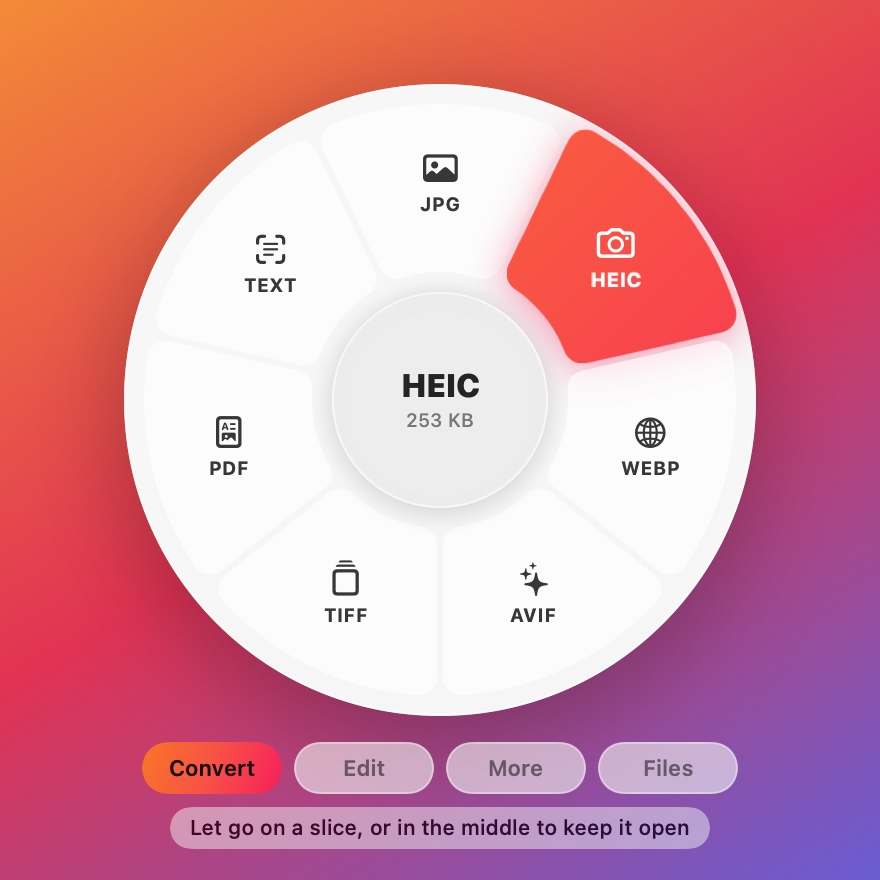
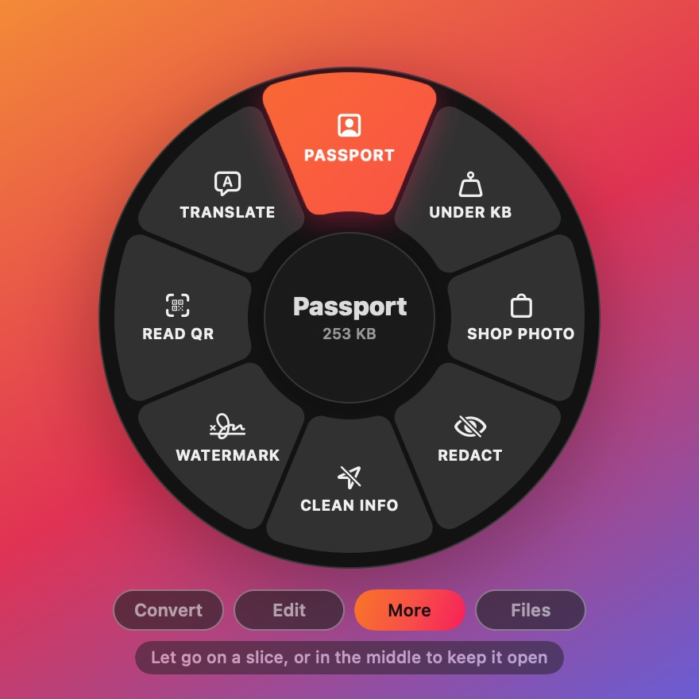
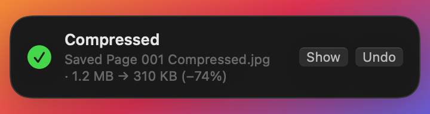

<h1 align="center">DragShift: free file converter for Mac and Windows</h1>

  <b>Wrong format? File too big for the form? PDF locked? Fix it in one drag.</b>

  Drag a file, press <b>Shift</b>, drop it on what you need. A new file appears next to the old one. 
  No uploads. No account. No ads. Free and open source.

  <a href="https://github.com/c0ldsheep/DragShift/releases/latest/download/DragShift.dmg"><b>Download for Mac</b></a>
  &nbsp;·&nbsp;
  <a href="https://github.com/c0ldsheep/DragShift/releases/latest/download/DragShift.exe"><b>Download for Windows</b></a>
  &nbsp;·&nbsp;
  <a href="https://c0ldsheep.github.io/DragShift/"><b>See the website</b></a>

  
  

## What it fixes

| Your problem | Drop the file on | Mac | Windows |
|---|---|:-:|:-:|
| The form says "photo must be under 50 KB" | **Under KB** (20 KB to 1 MB, or any size) | ✓ | ✓ |
| You need a passport size photo | **Passport** (3.5 × 4.5 cm on white, ready to print) | ✓ | ✓ |
| An iPhone photo (HEIC) won't open or upload | **JPG** or **PNG** | ✓ | ✓ |
| The PDF is too big to email | **Compress** | ✓ | ✓ |
| The site wants a PDF and you have a picture | **PDF** | ✓ | ✓ |
| The site wants MP4 and you have MOV | **MP4** | ✓ | ✓ |
| You need the words out of a picture or a scan | **Text** | ✓ | ✓ |
| The bank PDF asks for a password every time | **Unlock** | ✓ | |
| Many PDFs, one upload box | **Merge** | ✓ | |
| A phone number or ID number shows in a screenshot | **Redact** | ✓ | |

On Windows, HEIC photos need Microsoft's free HEIF extension from the Store.

It also crops, resizes, rotates, removes backgrounds, watermarks, zips, trims video, makes GIFs and prints.
The full list is in the [guide](docs/USING.md).

## How it works

1. **Start dragging a file**, from Finder, the Desktop, a browser or Photos.
2. **Press Shift.** A ring opens under the file. On a trackpad, touch a second finger. On a mouse, click the wheel.
3. **Drop the file on a slice.** Done.

Your original is never changed. A small bubble tells you what was saved, with **Show** and **Undo**.

  

## Why not a converter website?

- A website makes you **upload** your ID photo, your bank statement, your documents. DragShift never does: it has no
  internet code at all.
- No queue, no "wait 30 seconds", no watermark, no daily limit.
- It works with no internet.

## Download

**Mac** (macOS 13 or newer, Apple Silicon and Intel): [DragShift.dmg](https://github.com/c0ldsheep/DragShift/releases/latest/download/DragShift.dmg)

Open it, drag DragShift onto the Applications folder beside it, then open it from Applications. If macOS says it
can't check the app, open
System Settings → Privacy & Security, scroll down and click **Open Anyway**.

**Windows** (10 and 11): [DragShift.exe](https://github.com/c0ldsheep/DragShift/releases/latest/download/DragShift.exe)

One small file, nothing to install, no admin rights. If Windows says it protected your PC, click **More info**, then
**Run anyway**. Windows says this about new apps until enough people have opened them.

The Windows version has the main tools, not every Mac one yet. [What's in it](docs/WINDOWS.md).

## What it can do

| File | Tools |
|---|---|
| **Pictures** | Convert to JPG, PNG, HEIC, WebP, AVIF, TIFF, PDF · Compress · Under KB · Passport photo · Crop · Resize · Rotate · Remove background · Redact · Watermark · Read text · Read QR · Stitch into one long picture |
| **PDF** | To JPG or PNG pages · To Word or Text · Compress · Under KB · Merge · Split · Rotate · Lock · Unlock · Make a scan searchable |
| **Documents** | Word, RTF, ODT, HTML, Markdown and Text, to each other and to PDF · QR code |
| **Video and audio** | MP4, MOV, HEVC, GIF, MP3, M4A, WAV · Compress · Trim · 9:16 and 1:1 · Speed 2× · Mute |
| **Folders and zips** | Zip · Extract · Every picture to JPG · Pictures into one PDF |
| **Anything** | Print with one drop · Rename many files · Copy · AirDrop · Share |

Also: **favourites** on the edge of the screen, **recipes** (several steps in one drop), **watch folders** (every
HEIC that lands in Downloads becomes a JPG by itself) and a **clipboard shortcut** for screenshots.

## Private by design

- Your files stay on your computer. Nothing is uploaded, ever.
- No account, no ads, no tracking, no cookies.
- Open source under the MIT licence, so anyone can check.

More in [PRIVACY.md](PRIVACY.md) and [SECURITY.md](SECURITY.md).

## The website

**https://c0ldsheep.github.io/DragShift/** is a short 3D film you scroll through. A form closes at midnight. The
photo is too big and gets rejected. Then DragShift does it in one drag, and the form is submitted with minutes to spare.

It is our own code with no libraries, no cookies and no trackers, and it works offline after the first visit.
How it is made, tested and published: [docs/WEBSITE.md](docs/WEBSITE.md).

## Guides

- [Using it on a Mac](docs/USING.md): every way to open the ring and every tool
- [DragShift on Windows](docs/WINDOWS.md): what's in it, and how it differs
- [The website](docs/WEBSITE.md): the story, the code, the tests
- [Building, testing and releasing](docs/BUILDING.md): for people who edit the code

## Buy me a coffee

DragShift is free. If it saves you time, the app's About tab has a coffee cup: drag it, press Shift, and pick a size.
Or send any amount of ETH or USDC to `0x81fE1d0b00B3e6100E5e40E13982A3644e46e09A` (Ethereum; the same address
works on Base, Arbitrum and Polygon). Nothing in the app is locked or unlocked by a tip.

## Licence

MIT, see [LICENSE](LICENSE). Made by c0ldsheep. The licence covers the code. The DragShift name and icon aren't
part of it: if you publish your own build, give it your own name and icon, so nobody mistakes it for the official
download.
