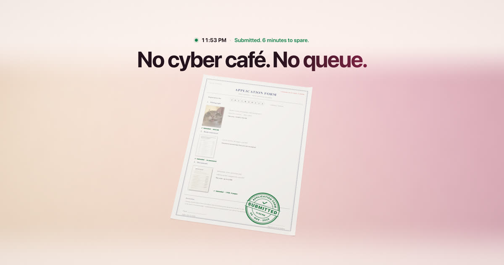

# The website

[← Back to the front page](../README.md)

**Address:** https://c0ldsheep.github.io/DragShift/

`site/` is DragShift's one-page site, "The Form": a short 3D film you scroll through. A government form on a desk,
closing at midnight. The photo is too big and gets rejected, you crop it and it's rejected again, then DragShift does
it in one drag: the photo goes under 50 KB, a locked bank PDF gets unlocked, three scans become one PDF, and a round
green SUBMITTED seal comes down from your side of the screen (phones give a short buzz). The film only moves while
you scroll, a little heavier at the moments that matter; Shift or the arrow keys jump to the next part. The last
part has the downloads.

- Our own code, no libraries and no downloads: the 3D is our own WebGL2 renderer (soft shadows, depth of field, a
  peach-to-pink studio backdrop), the papers are drawn in code, and the fonts are the system's. The page makes no
  requests after it loads (its security policy forbids them), uses no cookies and no trackers.
- Without WebGL or JavaScript, the page shows the same story as five still pictures.
- `./scripts/serve-site.py`, then open http://127.0.0.1:8000 (`./scripts/serve-site.py site 48780 --lan` also serves
  your phone on the same Wi-Fi). It always serves the newest files. ES modules don't run from `file://`.
- `cd site && node --test tests/*.test.js`: the film's timeline, words, scroll weights, the felt moments, the page's links and
  safety rules, and the version stamping.
- `cd site && swift tools/webkit-check.swift http://127.0.0.1:8000`: the page in Safari's engine, including a visit
  that opens behind another window, a very slow device and a file that fails to load.
- Test switches (only with `?test` or `?rec`): `&t=8.1` holds the film at one moment, `?rec` lets a recorder step it
  frame by frame. `site/tools/` has the recorder, the still-picture maker and an overlap checker for 4 screen sizes.
- `.github/workflows/site.yml` tests it, stamps every script address with the version (`site/tools/stamp.mjs`, so
  nobody runs half an old version from the cache) and publishes it with GitHub Pages on every push that touches `site/`
  (one-time: repo Settings → Pages → Source: GitHub Actions). The address is https://c0ldsheep.github.io/DragShift/.
- `site/DESIGN.md` has the story, the copy, the colours and the rules (no fake numbers, no urgency tricks).

## What a visitor gets

- The story in five parts, then two download buttons (Mac and Windows) that always fetch the newest release.
- "First time opening it?" help for the one warning macOS and Windows show for a new app.
- It works offline after the first visit, on phones too.
- For search engines and link previews: a plain title and description, a preview picture, and structured data that
  says what DragShift is (a free app for macOS and Windows).
